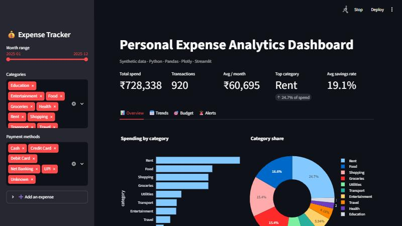
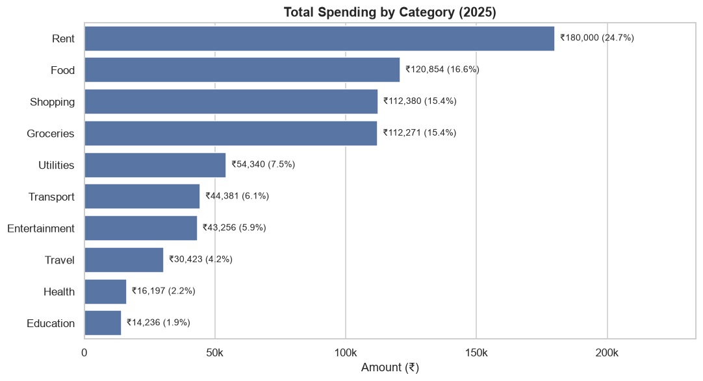
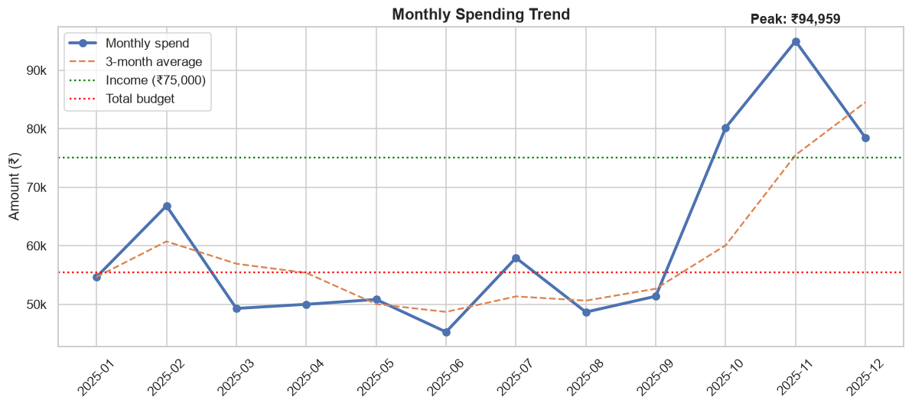
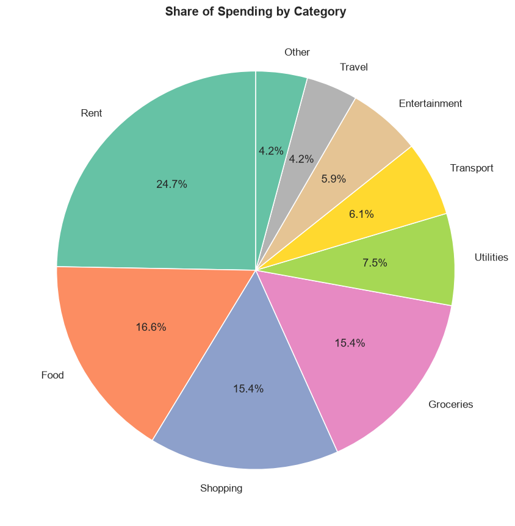
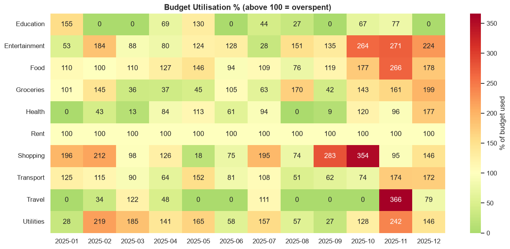
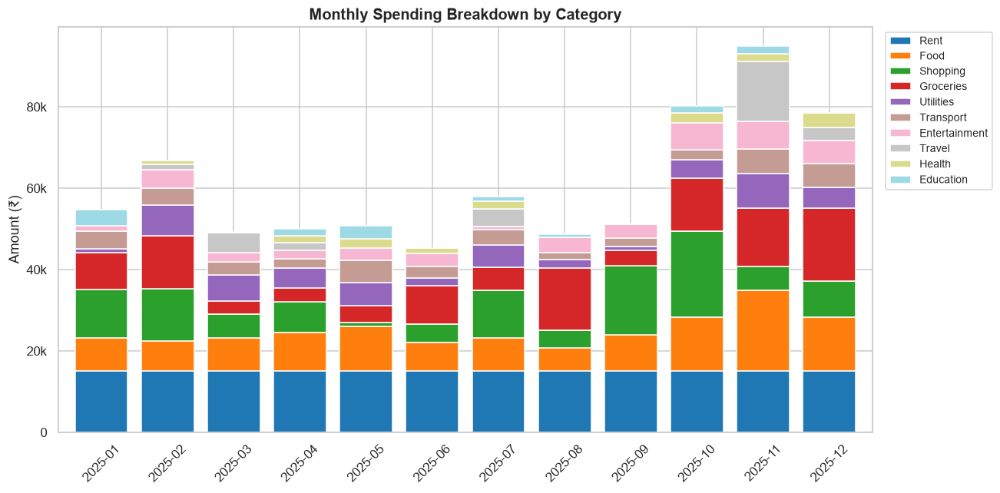
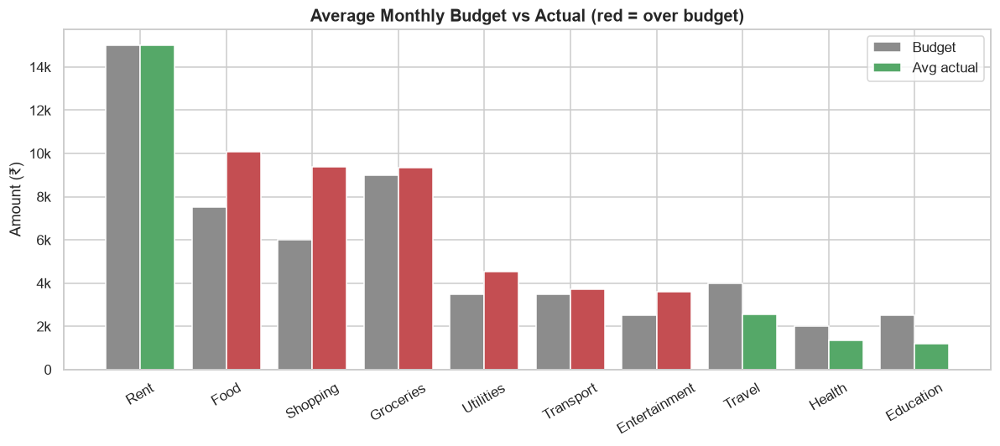
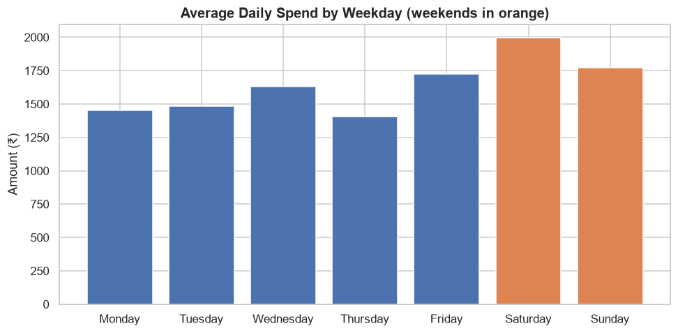
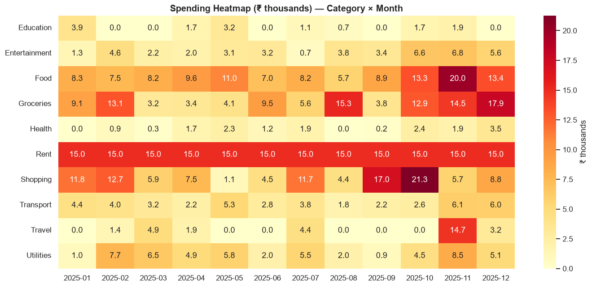

# 💰 Expense Tracker App using Data Science

> An end-to-end personal finance analytics project: synthetic data generation → cleaning → EDA → feature engineering → budget and anomaly analysis → charts → automated insights → interactive Streamlit dashboard.

   



---

## 📌 Overview
This project tracks and analyses one year of personal expenses (₹728K, 920 transactions across 10 categories). It finds where money goes, when spending spikes, which budgets are broken, and which transactions look unusual. It then turns those findings into plain-English recommendations.

Real bank data is private, so the project uses a **reproducible synthetic dataset** that models real behaviour: log-normal purchase sizes, fixed monthly rent, festive-season spikes (Oct–Dec), and higher weekend spending. It also includes **deliberately messy records** so the data-cleaning step is realistic.

## ❓ Problem
- People and small businesses don't know where their money goes each month.
- Overspending is usually noticed only after the money is gone.
- Raw transaction logs are messy (duplicates, missing values, inconsistent labels, mixed formats).

## ✅ Solution
A Python pipeline plus a dashboard that:
1. **Generates or ingests** expense records (date, category, amount, payment method).
2. **Cleans** them: removes duplicates, fixes types, standardises labels, and handles missing or negative values.
3. **Engineers features**: month, weekday, weekend flag, quarter, essential vs discretionary, and amount bucket.
4. **Analyses** category share, monthly trend, month-over-month change, savings rate, weekday patterns, budget vs actual, and z-score anomalies.
5. **Visualises** the results in 10 publication-quality charts and an interactive dashboard.
6. **Explains** the results with an auto-generated insights report and recommendations.

## ✨ Features
| Feature | Description |
|---|---|
| Synthetic data simulator | Reproducible (seeded) data with seasonality, weekend effect, and injected data-quality issues |
| Data cleaning report | Logs every fix (duplicates, nulls, negatives, formats) |
| Category analysis | Total, average, count, and share % for each category |
| Monthly trends | MoM % change, 3-month rolling average, savings rate |
| Budget tracking | Budget vs actual for each category and month, with an overspending report |
| Anomaly detection | Flags transactions that are unusually large for their category (z-score > 3) |
| Insights engine | Plain-English insights and recommendations → `outputs/insights_report.md` |
| Interactive dashboard | Filters, KPI cards, Plotly charts, alerts, an add-expense form, and CSV download |
| EDA notebook | Step-by-step exploration in `notebooks/expense_eda.ipynb` |

## 🛠 Tech Stack
**Python 3.10+** · **Pandas** · **NumPy** · **Matplotlib** · **Seaborn** · **Plotly** · **Streamlit** · **Jupyter**

## 📁 Project Structure
```
Expense-Tracker-App/
├── data/
│   ├── raw/expenses_raw.csv          # generated messy data
│   └── processed/expenses_clean.csv  # cleaned + feature-engineered data
├── notebooks/expense_eda.ipynb       # exploratory data analysis
├── src/
│   ├── config.py          # all settings: categories, budgets, income, paths
│   ├── data_generator.py  # synthetic data simulation
│   ├── cleaning.py        # cleaning + feature engineering
│   ├── analysis.py        # aggregations, budgets, anomalies, KPIs
│   ├── visualization.py   # 10 static charts
│   └── insights.py        # insights + recommendations + report
├── outputs/               # CSV tables + insights_report.md
├── images/                # charts and screenshots
├── docs/PROJECT_GUIDE.md  # full guide: architecture, simulation, interview prep
├── app.py                 # Streamlit dashboard
├── main.py                # runs the whole pipeline
├── requirements.txt
└── README.md
```

## 🚀 How to Run
```bash
git clone https://github.com/SNischayPrasad/Expense-Tracker-App.git
cd Expense-Tracker-App
python -m venv venv
venv\Scripts\activate          # Windows
# source venv/bin/activate     # Mac/Linux
pip install -r requirements.txt

python main.py                 # run the full pipeline
streamlit run app.py           # open the dashboard at http://localhost:8501
```
To analyse **your own expenses**, replace `data/raw/expenses_raw.csv` with a CSV that has the columns `transaction_id,date,category,description,amount,payment_method`. Then run `python main.py --use-existing`.

## 📊 Results
| Metric | Value |
|---|---|
| Total annual spend | ₹728,338 |
| Average monthly spend | ₹60,695 |
| Peak month | Nov 2025 (₹94,959) |
| Festive-season uplift (Oct–Dec) | **+60%** vs the rest of the year |
| Weekend vs weekday daily spend | **+22%** |
| Discretionary share | 42.1% |
| Average savings rate | 19.1% (3 months spent more than income) |
| Budget breaches | 53 category-months (Food over budget in 9 of 12 months) |
| Anomalies flagged | 15 transactions |

**Key recommendations:** cut Shopping and Food (₹49K and ₹33K over budget for the year), build a festival fund during Jan–Sep, and plan weekend spending in advance.

## 🖼 Screenshots
| Category spending | Monthly trend |
|---|---|
|  |  |
| **Category share** | **Budget utilisation** |
|  |  |
| **Monthly breakdown** | **Budget vs actual** |
|  |  |
| **Weekday pattern** | **Category × month heatmap** |
|  |  |

## 🔮 Future Improvements
- ML forecasting of next month's spend (Prophet / ARIMA / XGBoost)
- Auto-categorisation of bank SMS / statement text using NLP
- Email or push budget alerts; savings goal tracker
- SQLite/PostgreSQL storage, user login, and a mobile app

## 👤 Author
**Nischay** — aspiring Data / Business / Financial Analyst
GitHub: `SNischayPrasad` · LinkedIn: `<your-linkedin>`

## 📄 License
MIT. Free to use and learn from.
